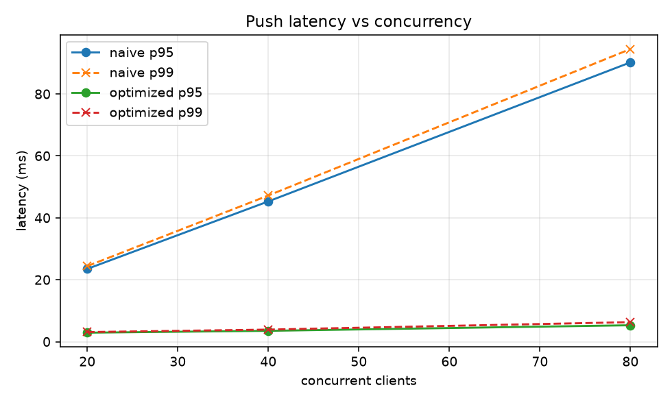
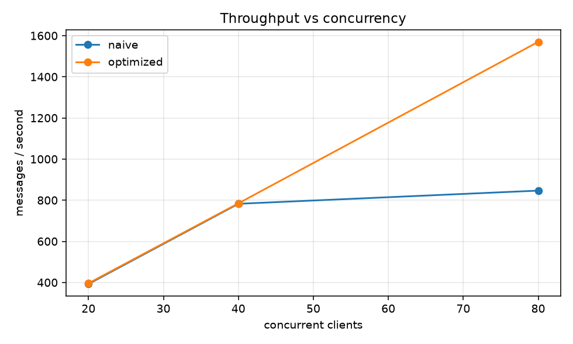

# LoadLab

WebSocket 长连接压测与容量拐点分析。

## 为什么单独做这个

HTTP 接口压测看 QPS 和响应时间；**长连接推送是另一回事**：

- 并发单位是「同时在线连接数」，不是「每秒请求数」；
- 服务端主动下行，一轮广播的开销会随订阅者数量线性增长；
- 真正的故障往往不是请求失败，而是**延迟随并发缓慢爬升，直到所有人都卡住**。

很多实现会在广播循环里对每个订阅者单独做一遍「转换 → 序列化 → 发送」（每个客户端要的字段、精度、单位都可能不一样）。连接少时完全没问题；连接一多，每轮广播的耗时就超过推送周期，积压开始出现，延迟随并发线性上升 —— 这就是队头阻塞在推送链路上的样子。

HTTP 压测工具看不到这个问题，因为它们不会持有长连接、也不会测「服务端主动推送」的延迟。

LoadLab 就是为这个场景写的：分级加压，测出推送延迟随并发的变化，找到拐点，并对比两种广播实现。

## 实验设计

`target/push_server.py` 提供两个服务，**唯一变量是广播方式**：

| 模式 | 广播实现 | 复杂度 |
|---|---|---|
| `naive` | 循环里逐订阅者处理并发送，一轮广播耗时随人数线性增长 | O(N) |
| `optimized` | 一份字节广播，逐订阅者入队由独立协程发送 | O(1) 序列化 + O(N) 入队 |

`--work-ms` 用来模拟「每个订阅者单独转换」的固定开销（字段裁剪、精度换算、加密等真实场景）。

### 一个被数据否掉的设计

最初的设计假设是「慢消费者拖垮广播循环」：让一个客户端连上后不读，期望 naive 因为 `await ws.send()` 阻塞而整体卡住。

实测结果是**两种模式完全一样**。原因是 `websockets` 的 `send()` 在写缓冲高水位时并不阻塞调用方，慢读的客户端要等缓冲区真正写满很久才会产生影响，在本地环回上几乎观察不到。

于是把实验轴换成了**逐订阅者处理开销** —— 这是真实系统里更常见的成本来源，也能稳定复现。这个失败的假设保留在仓库里，是因为它本身说明了一件事：**压测结论必须来自数据，不能来自直觉。**

## 实测数据

CI 环境（GitHub Actions，2 核，单机压测），推送间隔 50ms，`--work-ms 1`，每档 6 秒：

| 并发 | naive p50 | naive p95 | naive 吞吐 | optimized p50 | optimized p95 | optimized 吞吐 |
|---:|---:|---:|---:|---:|---:|---:|
| 20 | 12.9 ms | 23.5 ms | 392.7 /s | 2.1 ms | 2.9 ms | 396.1 /s |
| 40 | 24.3 ms | 45.3 ms | 782.5 /s | 2.8 ms | 3.5 ms | 784.7 /s |
| 80 | 47.9 ms | 90.2 ms | 846.6 /s | 4.2 ms | 5.3 ms | 1569.8 /s |





三个结论：

1. **naive 的延迟随并发线性增长**（20→80 并发，p95 从 23.5ms 涨到 90.2ms，约 3.8 倍），因为每轮广播耗时 = 人数 × 单人开销，第 N 个订阅者永远拿到最旧的那条消息；
2. **naive 的吞吐在 80 并发时封顶**（846/s），因为一轮广播耗时（80ms）已经超过推送周期（50ms），系统进入持续积压；
3. **optimized 在同一并发下吞吐高 1.85 倍、p95 低 17 倍**，且曲线基本持平 —— 因为它把「逐人处理」变成了「一次处理 + 分发」。

这组数据就是「为什么广播要共享一份序列化结果」的量化依据。

## 快速开始

```bash
pip install -e ".[dev]"

# 起目标服务
python target/push_server.py --port 8765 --mode naive --interval 0.05 --work-ms 1 \
    --stats report/server-stats.jsonl

# 另开窗口：分级加压
loadlab run --target ws://127.0.0.1:8765 \
            --stages 20,40,80 \
            --duration 6 \
            --server-stats report/server-stats.jsonl \
            --out report/naive.json

# 生成图表与报告
loadlab report --inputs report/naive.json --labels naive --out report
```

对比两种实现：

```bash
loadlab report --inputs report/naive.json report/optimized.json \
               --labels naive optimized --out report
```

## 指标口径

| 指标 | 定义 |
|---|---|
| 延迟 | 客户端收到时刻 − 服务端写入报文的 `sentAt`（毫秒），**同机压测**可用；跨机需要额外的时钟同步 |
| p50 / p95 / p99 | 全部客户端的全部消息样本一起算，线性插值，与 Prometheus summary 口径一致 |
| 吞吐 | 所有客户端收到的消息总数 ÷ 本档实际耗时 |
| 错误率 | 连接失败 / 异常断开的客户端数 ÷ 并发数 |
| 丢帧 | 服务端统计的 `dropped` 增量（仅 optimized 模式会产生） |
| 事件循环延迟 | 服务端每秒采样，判断是否被同步代码堵住 |

## 拐点怎么判

只看「p95 超过 100ms」不行 —— 不同机器基线差很远。判定规则是**相对自己**：

- p95 比上一档翻倍，且绝对值超过 50ms；或
- 开始出现连接错误 / 丢帧。

上面这组数据没有触发判定（80 并发时 p95 恰好没到上一档的 2 倍），但延迟的线性趋势在表格里一眼可见 —— **判定规则是辅助，趋势才是结论**。

## 产物

`loadlab report` 生成：

- `latency.png`：p95/p99 随并发变化
- `throughput.png`：吞吐随并发变化
- `report.md`：逐档表格 + 拐点判定 + 复现命令

## 结构

```
loadlab/
├─ loadlab/
│  ├─ client.py     # 压测客户端：连接、收推送、量延迟（支持停滞模式）
│  ├─ runner.py     # 分级加压编排、服务端指标切片
│  ├─ stats.py      # 分位数、汇总、拐点判定
│  ├─ report.py     # 图表与 Markdown
│  └─ cli.py        # 命令行
├─ target/
│  └─ push_server.py  # 被测服务（naive / optimized）
└─ tests/             # 含真实起服务的集成测试
```

## 已知限制

- 压测端与被测端在**同一台机器**上，会互相抢 CPU；真实容量评估应分机部署，本仓库的数字只能作相对比较；
- `--work-ms` 是对「逐订阅者处理开销」的模拟，不是真实业务逻辑；换到真实系统时该参数应由实际 profiler 数据标定；
- 延迟口径依赖两端时钟，同机可用，跨机需要 NTP 或改用单向时延测量；
- 未覆盖上行订阅、鉴权、重连风暴等场景；
- `optimized` 的队列满策略是「丢弃新帧并计数」，生产环境更常见的是背压 + 降采样。

## 参考

- 队头阻塞与背压的思路参考 Kafka consumer 与 Netty write buffer 的公开设计文档；
- 分位数算法参考 Prometheus summary 的线性插值口径；
- 代码为自行实现，未引用上述项目源码。

## License

MIT
